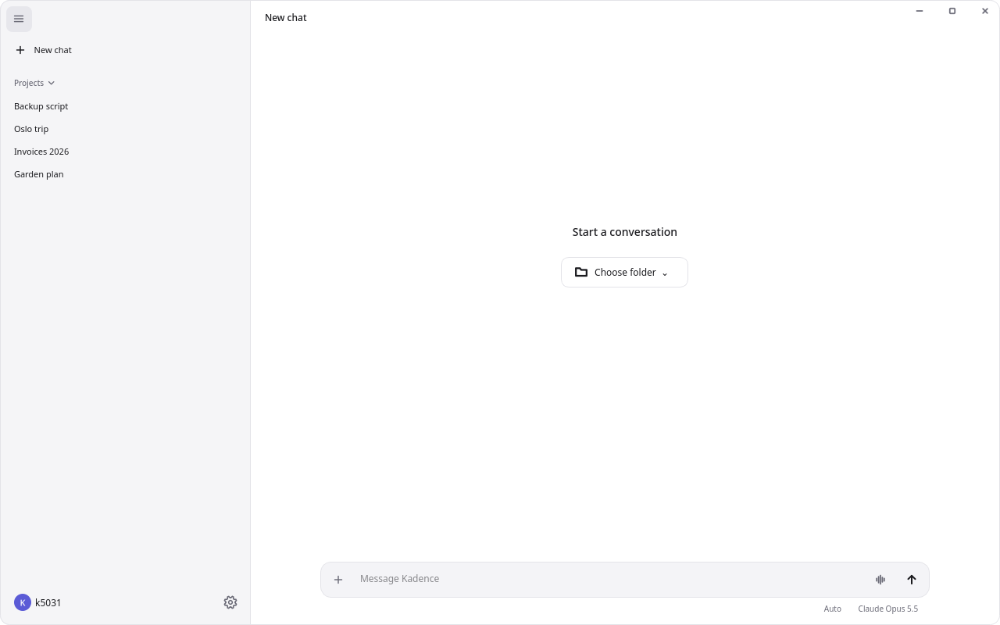

# Kaden

An AI agent for your computer, in a desktop app. It runs commands, works with
files and searches the web, decides on its own only what is safe and asks you about the
rest, and stops at hard spending limits. Works with Anthropic, DeepSeek and
OpenAI-compatible models.

<picture>
  <source media="(prefers-color-scheme: dark)" srcset="docs/images/empty-dark.png">
  
</picture>

The [desktop app](docs/desktop-app.md), ready for a new chat.

A runtime drives four swappable modules (Core, Memory, Tools, Frontend); see
`src/kaden/api.py` and `SPEC.md`.

## Download

**[Get Kaden from the latest release](https://github.com/K5031/Kaden/releases/latest)**,
for Linux:

| Your system | Download | Install |
|---|---|---|
| Ubuntu 24.04 or 26.04 | the `.deb` named for it (`noble`, `resolute`) | open it, or `sudo apt install ./kaden-desktop_*.deb` |
| Fedora 44 | the `.rpm` | open it, or `sudo dnf install ./kaden-desktop-*.rpm` |
| Arch | the `.pkg.tar.zst` | `sudo pacman -U kaden-desktop-*.pkg.tar.zst` |

Then start **Kaden** from your apps. The first time, it asks which AI provider you use
(Anthropic, DeepSeek or OpenAI) and your key for it. `kaden` also starts it from a
terminal. Other systems, and the GPU voice, install from source: see
[Getting started](docs/getting-started.md).

Kaden works freely in the folder you choose for a chat; anything outside it gets a quick
automatic check, and Kaden asks you when it is unsure. Choose a folder made for it;
your home folder is too broad to count.

## Documentation

The [documentation](docs/README.md) covers getting started, using Kaden, settings, the
concepts behind it and development.

## Contributing

See [CONTRIBUTING.md](CONTRIBUTING.md).

## License

GNU Affero General Public License, version 3 or later; see `LICENSE`. Contributions
need a signed [Contributor License Agreement](CLA.md).
